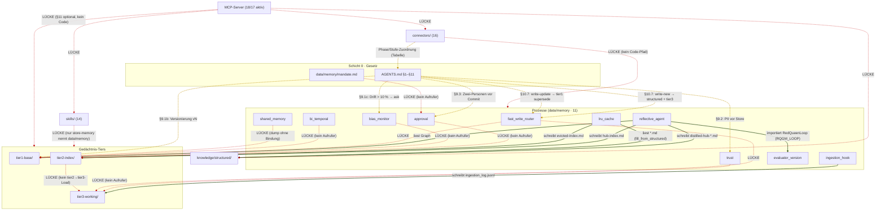

# Verbindungen-Diagramm (alle Elemente → alle Elemente)

> Datum: 2026-10-03 · Lab-Prinzip §6: **nur belegte Kanten** (Code oder Doku).
> Nicht belegte Kanten sind explizit **LÜCKE** (kein Code/Doku-Pfad vorhanden).
> Methode: `grep` über `data/memory/**`, `skills/**`, `connectors/**`, `AGENTS.md`.

## 0. Kernbefund (ehrlich, vorab)

- **Code-Kanten (wirklich verdrahtet): 7** — alle über Datei-Pfade in `data/memory/**`.
- **MCP-Server sind NICHT im Code angebunden** — ihre Namen kommen nur in
  Kommentaren/Docstrings vor (`grep` ohne Treffer auf echte Aufrufe). §11 sagt:
  MCP = *optional über* der lokalen Memory → konzeptionell, nicht verdrahtet.
- **Cross-Import in `data/memory/`: genau 1** (`reflective_agent → evaluator_version`).
- Alles „X → alle" (trust/approval/bias_monitor/bi_temporal/mandate) hat **keine
  Aufrufer** → LÜCKE.

## 1. Diagramm (Mermaid) — solide = Code, gepunktet = Doku, rot = LÜCKE

## 2. Tabelle aller Verbindungen

Legende Quelle: `Datei:Zeile` = Code-Beleg · `AGENTS.md §` = Doku/Auftrag ·
**LÜCKE** = kein Code- oder Doku-Pfad.

### 2.1 Vertikale Verbindungen (MCP als Brücke) — alle LÜCKE

| von → nach | was fließt | Bedingung | Quelle |
|---|---|---|---|
| MCP → tier1/2/3 · structured · connectors · skills | lesen/suchen/schreiben/linken | Scope + Tri-Color-Trust | **GESCHLOSSEN 2026-10-03**: `data/memory/mcp_memory_server.py` (5 Tools: memory.read/write/search/consolidate/link; `ergebnisse/mcp-memory.md`) |

> Die früheren 6 MCP-LÜCKEN sind durch den MCP-Memory-Server geschlossen
> (Rekursion/Feature 2026-10-03): MCP exponiert tier1/2/3 + knowledge/structured +
> connectors + skills über die 5 Kern-Tools. Quelle: Atomic (MCP-Interface) +
> ATHENA (Tri-Color Trust).

> Beleg für die LÜCKE: `grep -riE "graphiti\|cognee\|hela" data/memory/*.py` →
> nur Docstrings/Kommentare, **keine** Aufrufe.

### 2.2 Horizontale Verbindungen (zwischen Schichten)

| von → nach | was | Bedingung | Quelle |
|---|---|---|---|
| tier1-base → tier2-index | Hub → Konzept-Index | Hub erkannt (`D(v) > δ_hub`) | **Code**: `reflective_agent.py:24,351-353` |
| tier2-index → tier3-working | Konzept in Cache laden | — | **LÜCKE** (lru lädt aus `knowledge/structured`, nicht aus tier2) |
| tier3-working → tier2-index | Eviction | Kapazität > 15 bzw. Forgetting | **Code**: `lru_cache.py:26,228-229` |
| knowledge/structured → tier3-working | Initialbefüllung | `relevance ≥ min_relevance` | **Code**: `lru_cache.py:146` |
| tier1-base (Hub) → knowledge/structured | Destillation | `detect_hubs` | **Code**: `reflective_agent.py:25,334-336` |
| skills → data/memory | Fakt ablegen | — | **Doku** (`skills/store-memory/SKILL.md:43`), Code: **LÜCKE** |
| connectors → processes | — | — | **LÜCKE** (Connectoren sind `.md`) |

### 2.3 Prozess-Verbindungen

| von → nach | was | Bedingung | Quelle |
|---|---|---|---|
| fast_write_router → tier3-working | Klassen-Aktion | write-new | **LÜCKE** (Code liefert nur `class`, kein Write) |
| fast_write_router → tier1-base | Supersede | write-update | **LÜCKE** (nur `AGENTS.md §10.7`) |
| reflective_agent → tier1-base | liest Graph (Hub-Destillation) | immer | **Code**: `reflective_agent.py:24,203,369` |
| ingestion_hook → tier3-working | Lifecycle-Log | jedes Event | **Code**: `ingestion_hook.py:47,386-389` |
| lru_cache → tier2-index | Eviction | Kapazität/Forgetting | **Code**: `lru_cache.py:228-229` |
| trust → alle | PII-Filter vor Write | — | **LÜCKE** (kein Aufrufer; `ingestion_hook` hat eigenen `PrivacyFilter`) |
| approval → alle | §9.3-Gate vor Commit | — | **LÜCKE** (Prozessregel, kein Code-Aufruf) |
| bias_monitor → alle | Drift-Erkennung | `DI > τ` | **LÜCKE** (kein Aufrufer) |
| bi_temporal → alle | valid × transaction time | — | **LÜCKE** (kein Aufrufer) |
| shared_memory → tier1-base | ACL + Trust + Sync | `dump(path)` | **LÜCKE** (Pfad wird vom Aufrufer gegeben, keine Bindung) |
| evaluator_version → reflective_agent | Red-Queen-Loop | `RQGM_LOOP != 0` | **Code**: `reflective_agent.py:395` |
| mandate → alle | Erweiterungs-Gate `ask` | Erweiterungsversuch | **LÜCKE** (kein Aufrufer) |

### 2.4 Skill-Verbindungen (14 Skills)

| Skill → Prozess | Quelle |
|---|---|
| collect-experience · structure-knowledge · store-memory · cognize · reflect · non-cognitive · act · expand-knowledge → Prozesse | **LÜCKE** (kein SKILL.md nennt einen Prozessnamen; nur `store-memory` nennt `data/memory/` generisch, `SKILL.md:43`) |
| recursive-improve → Phasen konstrukt/akt/observe/compare/revise | **Doku**: `skills/recursive-improve/{konstrukt,akt,observe,compare,revise}/SKILL.md` (Ordner vorhanden) |

### 2.5 Connector-Verbindungen (16 Connectoren)

| Connector → Stufe | Quelle (Doku) |
|---|---|
| affective-signals → Nicht-Kognition (6) | `AGENTS.md:390` |
| cognee-memory → Gedächtnis (3), Kognition (4) | `AGENTS.md:382` |
| hela-semantic → Wissen (2), Wissen+ (8) | `AGENTS.md:381` |
| mars-seaa → Denken (5) | `AGENTS.md:384-385` |
| reflexion-trace → Kognition/Reflexion (4) | `connectors/reflexion-trace.md` (Stufen-Zuordnung) |
| (übrige 11 Connectoren) → Phase/Stufe | `AGENTS.md:378-392` (Tabelle) |
| Connector → **Prozess** (Code) | **LÜCKE** |

## 3. Zusammenfassung der LÜCKEN

1. ~~**MCP ↔ alles**: keine Code-Anbindung.~~ → **GESCHLOSSEN 2026-10-03** durch
   `data/memory/mcp_memory_server.py` (5 Tools, Tri-Color-Gate); Details `ergebnisse/mcp-memory.md`.
2. **„→ alle"-Module** (trust, approval, bias_monitor, bi_temporal, mandate):
   existieren, haben aber **keine Aufrufer**.
3. **fast_write_router → Memory**: Klassifikation vorhanden, **Write-Aktion fehlt**.
4. **tier2 → tier3**: kein Ladepfad (lru lädt aus `knowledge/structured`).
5. **skills → Prozesse**: keine Prozessnamen in den Skills.
6. **connectors → Prozesse**: Connectoren sind reine Dokumentation.

## 4. Quellen (geprüft)

- Code: `data/memory/{reflective_agent,ingestion_hook,fast_write_router}.py`,
  `data/memory/tier3-working/lru_cache.py`, `data/memory/{trust,approval,bias_monitor,bi_temporal,mandate,evaluator_version}.py`,
  `data/memory/shared/shared_memory.py`
- Doku: `AGENTS.md` §9–§11 + Connector-Tabelle (`AGENTS.md:378-392`),
  `skills/store-memory/SKILL.md`, `data/memory/README.md`
- Methode: `grep -rn` über `data/memory/**`, `skills/**`, `connectors/**`
