# Verbindungen-Diagramm (alle Elemente → alle Elemente)

> Datum: 2026-10-03 (konsolidiert) · Lab-Prinzip §6: **nur belegte Kanten** (Code oder Doku).
> Nicht belegte Kanten sind **LÜCKE**. Methode: `grep -rn` über `data/memory/**`,
> `skills/**`, `connectors/**`, `AGENTS.md`.
> Legende: **CODE** = verdrahtet (`Datei:Zeile`) · **DOKU** = Auftrag/Regel ·
> **LÜCKE** = kein Code/Doku-Pfad.

## 0. Kernbefund (Ist-Stand, verifiziert)

- **Module in `data/memory/**`: 13** (11 top-level + `shared/shared_memory.py` +
  `tier3-working/lru_cache.py`).
- **Code-Kanten: 7 direkte** + **Pipeline-Kanten** (`pipeline.py` ruft 5 Module).
- **Cross-Import in `data/memory/`: 1** (`reflective_agent → evaluator_version`).
- „→ alle"-Module (`trust`, `approval`, `bias_monitor`, `bi_temporal`, `mandate`)
  werden von `pipeline.py` **aufgerufen** → geschlossen.
- **MCP-Server** werden **extern** gestartet (opencode), nicht importiert; der
  MCP-Memory-Server exponiert die Tiers über 5 Tools → geschlossen.
- **MCP-Registry: 19 Einträge · 16 aktiv** (context7, sqlalchemy-mcp, visuals-mcp deaktiviert).

## 1. Diagramm (Mermaid)

Kanten-Label trägt die Art: `CODE:` (grün, verdrahtet) · `DOKU:` (Auftrag) · `LÜCKE:` (offen).

```mermaid
flowchart TB
  classDef code fill:#E2EFDA,stroke:#375623,stroke-width:2px;
  classDef docu fill:#FFF2CC,stroke:#BF8F00;
  classDef gap  fill:#FBE5D6,stroke:#C00000,stroke-dasharray:4 2;

  LAW["AGENTS.md §1–§11"]:::docu
  MAND["mandate.md"]:::docu

  subgraph PROC["Prozesse (13)"]
    FWR["fast_write_router"]:::code
    REF["reflective_agent"]:::code
    ING["ingestion_hook"]:::code
    LRU["lru_cache"]:::code
    TRU["trust"]:::code
    APP["approval"]:::code
    BM["bias_monitor"]:::code
    BT["bi_temporal"]:::code
    SH["shared_memory"]:::gap
    EV["evaluator_version"]:::code
    MPY["mandate.py"]:::code
    PIPE["pipeline"]:::code
    MCPSRV["mcp_memory_server"]:::code
  end

  subgraph TIER["Gedächtnis-Tiers"]
    T1["tier1-base/"]:::code
    T2["tier2-index/"]:::code
    T3["tier3-working/"]:::code
  end
  KS["knowledge/structured/"]:::code
  SK["skills/ (14)"]:::docu
  CN["connectors/ (16)"]:::docu
  MCP["MCP-Server (19/16 aktiv)"]:::code
  TST["tests/ + CI (221 Tests, 100 %)"]:::code

  %% CODE-Kanten (verdrahtet)
  REF -->|"CODE: liest Graph"| T1
  REF -->|"CODE: distilled-hub-*.md"| KS
  REF -->|"CODE: hub-index.md"| T2
  REF -->|"CODE: import RedQueenLoop"| EV
  ING -->|"CODE: ingestion_log.jsonl"| T3
  LRU -->|"CODE: liest *.md"| KS
  LRU -->|"CODE: evicted-index.md"| T2
  PIPE -->|"CODE: mandate.assess"| MPY
  PIPE -->|"CODE: trust.PIIFilter"| TRU
  PIPE -->|"CODE: approval.TwoPersonApproval"| APP
  PIPE -->|"CODE: bi_temporal.assert_fact"| BT
  PIPE -->|"CODE: bias_monitor.observe"| BM
  PIPE -->|"CODE: write-new"| KS
  PIPE -->|"CODE: write-new"| T3
  PIPE -->|"CODE: load_from_tier2"| T3
  MCPSRV -->|"CODE: 5 Tools"| T1
  MCPSRV -->|"CODE: 5 Tools"| T2
  MCPSRV -->|"CODE: 5 Tools"| T3
  MCPSRV -->|"CODE: 5 Tools"| KS
  MCPSRV -->|"CODE: 5 Tools"| CN
  MCPSRV -->|"CODE: 5 Tools"| SK
  TST -.->|"CODE: prüft"| PIPE

  %% DOKU-Kanten (Auftrag)
  LAW -.->|"DOKU: §10.7 write-new/update"| FWR
  LAW -.->|"DOKU: §9.2 PII"| TRU
  LAW -.->|"DOKU: §9.3 Zwei-Personen"| APP
  LAW -.->|"DOKU: §9.1c Drift"| BM
  LAW -.->|"DOKU: §9.1b Versionierung vN"| T1
  CN -.->|"DOKU: Phase/Stufe"| LAW
  SK -.->|"DOKU: Skill→Prozess (README)"| PIPE

  %% LÜCKEN (offen)
  PIPE -.->|"LÜCKE: classify injiziert"| FWR
  SH -.->|"LÜCKE: dump ohne Bindung"| T1
  CN -.->|"LÜCKE: kein Code-Pfad"| PROC
```

## 2. Tabelle aller Verbindungen

### 2.1 MCP → Scopes (geschlossen)

| von → nach | was | Bedingung | Quelle |
|---|---|---|---|
| `mcp_memory_server` → tier1/2/3 · structured · connectors · skills | read/write/search/consolidate/link | Scope + Tri-Color-Trust | **CODE**: `mcp_memory_server.py:37-43` (`SCOPES`), `ergebnisse/mcp-memory.md` |

### 2.2 Horizontale Verbindungen

| von → nach | was | Bedingung | Quelle |
|---|---|---|---|
| tier1-base → tier2-index | Hub → Konzept-Index | Hub (`D(v) > δ_hub`) | **CODE**: `reflective_agent.py:24,351-353` |
| tier2-index → tier3-working | Laden | — | **CODE**: `pipeline.py:load_from_tier2` |
| tier3-working → tier2-index | Eviction | Kapazität > 15 / Forgetting | **CODE**: `lru_cache.py:26,228-229` |
| knowledge/structured → tier3-working | Initialbefüllung | `relevance ≥ min_relevance` | **CODE**: `lru_cache.py:146` |
| tier1-base (Hub) → knowledge/structured | Destillation | `detect_hubs` | **CODE**: `reflective_agent.py:25,334-336` |
| skills → data/memory | Fakt ablegen | — | **DOKU**: `skills/README.md` (Mapping) |
| connectors → processes | Zuordnung | — | **DOKU**: §5 unten |

### 2.3 Prozess-Verbindungen

| von → nach | was | Bedingung | Quelle |
|---|---|---|---|
| fast_write_router → tier3-base/structured | Klassen-Aktion | write-new | **CODE**: `pipeline.route_and_store` (classify injiziert) |
| fast_write_router → tier1-base | Supersede | write-update | **CODE**: `pipeline` + `bi_temporal.assert_fact` |
| reflective_agent → tier1-base | liest Graph | immer | **CODE**: `reflective_agent.py:24,203,369` |
| ingestion_hook → tier3-working | Lifecycle-Log | jedes Event | **CODE**: `ingestion_hook.py:47,386-389` |
| lru_cache → tier2-index | Eviction | Kapazität/Forgetting | **CODE**: `lru_cache.py:228-229` |
| trust → alle | PII vor Write | — | **CODE**: `pipeline.py` (`trust.PIIFilter`) |
| approval → alle | §9.3-Gate | self_update | **CODE**: `pipeline.py` (`approval.TwoPersonApproval`) |
| bias_monitor → alle | Drift | `DI > τ` | **CODE**: `pipeline.py:drift_gate` |
| bi_temporal → alle | valid × transaction | — | **CODE**: `pipeline.py` (`BiTemporalStore`) |
| shared_memory → tier1-base | ACL + Sync | `dump(path)` | **LÜCKE** (Pfad vom Aufrufer, 0 Aufrufer) |
| evaluator_version → reflective_agent | Red-Queen | `RQGM_LOOP != 0` | **CODE**: `reflective_agent.py:395` |
| mandate → alle | Gate `ask` | Erweiterung | **CODE**: `pipeline.py` (`mandate.assess`) |

### 2.4 Skill-Verbindungen (14 Skills)

| Skill → Prozess | Quelle |
|---|---|
| 8 Stufen-Skills → Prozesse | **DOKU**: `skills/README.md` (Zuordnung, Status Auftrag) |
| recursive-improve → Phasen konstrukt/akt/observe/compare/revise | **DOKU**: `skills/recursive-improve/*/SKILL.md` |

### 2.5 Connector-Verbindungen (16)

| Connector → Stufe | Quelle (Doku) |
|---|---|
| affective-signals → Nicht-Kognition (6) | `AGENTS.md:390` |
| cognee-memory → Gedächtnis (3), Kognition (4) | `AGENTS.md:382` |
| hela-semantic → Wissen (2), Wissen+ (8) | `AGENTS.md:381` |
| mars-seaa → Denken (5) | `AGENTS.md:384-385` |
| reflexion-trace → Kognition/Reflexion (4) | `connectors/reflexion-trace.md` |
| (übrige) → Phase/Stufe | `AGENTS.md:378-392` |
| Connector → **Prozess** (Code) | **LÜCKE** (Connectoren sind `.md`) |

## 3. Lücken (konsolidiert)

**Geschlossen:**
1. MCP ↔ Scopes — `mcp_memory_server.py` (5 Tools, Tri-Color).
2. „→ alle"-Module — `pipeline.py` (5 Aufrufer).
3. fast_write_router → Memory — `pipeline.route_and_store`.
4. tier2 → tier3 — `pipeline.load_from_tier2`.
5. skills → Prozesse — `skills/README.md` (Doku/Auftrag).
6. connectors → Prozesse — §5 (Doku).

**Offen (echt):**
- A. `pipeline.py` hat **0 Aufrufer** → Kette wird nicht automatisch ausgelöst.
- B. `pipeline → fast_write_router` nur **injiziert** (`classify_fn`), nicht hart verdrahtet.
- C. `shared_memory → tier1-base`: **0 Aufrufer** (dump ohne Bindung).
- D. `skills`/`connectors` → Prozesse: nur **DOKU** (kein Code-Enforcement).

## 4. Quellen (geprüft)

- Code: `data/memory/{reflective_agent,ingestion_hook,fast_write_router,trust,approval,bias_monitor,bi_temporal,mandate,evaluator_version,pipeline,mcp_memory_server}.py`,
  `data/memory/tier3-working/lru_cache.py`, `data/memory/shared/shared_memory.py`
- Doku: `AGENTS.md` §9–§11 + Connector-Tabelle (`AGENTS.md:378-392`),
  `skills/README.md`, `data/memory/README.md`, `ergebnisse/mcp-memory.md`
- Methode: `grep -rn` über `data/memory/**`, `skills/**`, `connectors/**`

## 5. Pipeline-Kanten + Connector → Prozess

| Kante | was | Quelle (Code) |
|---|---|---|
| pipeline → mandate | Mandat-Gate | `mandate.assess` |
| pipeline → trust | PII vor Store | `trust.PIIFilter().minimize` |
| pipeline → approval | §9.3-Gate | `approval.TwoPersonApproval` |
| pipeline → bi_temporal | Supersede | `bi_temporal.BiTemporalStore.assert_fact` |
| pipeline → bias_monitor | Drift-Gate | `bias_monitor.BiasDriftMonitor.observe` |
| pipeline → structured/tier3 | Write (write-new) | Dateipfade |
| pipeline.load_from_tier2 → tier3 | Ladepfad | Dateikopie |

| Connector | Prozess/Stufe | Quelle |
|---|---|---|
| fast-write-routing | `fast_write_router` | `AGENTS.md §10` |
| cognee-memory · cognee-validation | `reflective_agent` | `AGENTS.md:382` |
| hela-semantic · hela-evolution | `reflective_agent` | `AGENTS.md:381,388` |
| mars-seaa | `bias_monitor` (HMM) | `AGENTS.md:384-385` |
| governance-mcp | `bias_monitor` + Lyapunov | `AGENTS.md:392` |
| affective-signals | `trust` (Nicht-Kognition) | `AGENTS.md:390` |
| agento-ariadne | `shared_memory` (Tier 1) | `AGENTS.md:378-379` |
| (übrige) | Phase/Stufe laut Tabelle | `AGENTS.md:378-392` |
