# Verbindungen-Diagramm (alle Elemente → alle Elemente)

> Datum: 2026-10-03 (konsolidiert + CI-Integration 042) · Lab-Prinzip §6: **nur belegte Kanten** (Code oder Doku).
> Nicht belegte Kanten sind **LÜCKE**. Methode: `grep -rn` über `data/memory/**`,
> `skills/**`, `connectors/**`, `AGENTS.md`.
> Legende: **CODE** = verdrahtet (`Datei:Zeile`) · **DOKU** = Auftrag/Regel ·
> **LÜCKE** = kein Code/Doku-Pfad.

## 0. Kernbefund (Ist-Stand, verifiziert)

- **Module in `data/memory/**`: 13** (11 top-level + `shared/shared_memory.py` +
  `tier3-working/lru_cache.py`).
- **Code-Kanten: 7 direkte** + **Pipeline-Kanten** (`pipeline.py` ruft 7 Module:
  `mandate`, `trust`, `approval`, `bi_temporal`, `bias_monitor`, `fast_write_router`,
  `shared_memory`).
- **Cross-Import in `data/memory/`: 1** (`reflective_agent → evaluator_version`).
- „→ alle"-Module (`trust`, `approval`, `bias_monitor`, `bi_temporal`, `mandate`)
  werden von `pipeline.py` **aufgerufen** → geschlossen.
- **MCP-Server** werden **extern** gestartet (opencode), nicht importiert; der
  MCP-Memory-Server exponiert die Tiers über 5 Tools → geschlossen.
- **MCP-Registry: 19 Einträge · 16 aktiv** (context7, sqlalchemy-mcp, visuals-mcp deaktiviert).
- **A–D geschlossen:** pipeline hat Aufrufer (Hub + Experience-Eintritt), FWR hart
  verdrahtet, shared_memory exportiert, Mappings CI-enforced.
- **Stand 2026-10-03 (D):** Datei ↔ Code abgeglichen; LÜCKEN (`shared_memory`,
  `connectors`) korrigiert, tote Knoten (`MAND`, `MCP`) verdrahtet.
- **Stand 2026-10-03 (CI-Integration, Rekursion 042):** ein `verify`-Job (Python 3.12,
  keine 3.9-Matrix) prüft Code + Doku (interne Links) + Artefakte + Secrets + Endpoint
  (Preflight) + Modell-IDs + Snapshots (`vN`) + Connector-Konsistenz + Provenienz.
  **Offen (nicht verdrahtet):** `ci_drift`, `pre-commit`, `gitleaks`-Action, Live-MCPs,
  Branch-Protection, Windows/macOS.

## 1. Diagramm (Mermaid)

Kanten-Label trägt die Art: `CODE:` (grün, verdrahtet) · `DOKU:` (Auftrag) · `LÜCKE:` (offen).

```mermaid
flowchart TB
  classDef code fill:#E2EFDA,stroke:#375623,stroke-width:2px;
  classDef docu fill:#FFF2CC,stroke:#BF8F00;
  classDef gap  fill:#FBE5D6,stroke:#C00000,stroke-dasharray:4 2;

  LAW["AGENTS.md §1–§11"]:::docu
  MAND["mandate.md"]:::docu

  subgraph PROC["Prozesse (14)"]
    FWR["fast_write_router"]:::code
    REF["reflective_agent"]:::code
    ING["ingestion_hook"]:::code
    LRU["lru_cache"]:::code
    GEX["gaama_extract"]:::code
    TRU["trust"]:::code
    APP["approval"]:::code
    BM["bias_monitor"]:::code
    BT["bi_temporal"]:::code
    SH["shared_memory"]:::code
    EV["evaluator_version"]:::code
    MPY["mandate.py"]:::code
    PIPE["pipeline"]:::code
    MCPSRV["mcp_memory_server"]:::code
  end

  subgraph TIER["Gedächtnis-Tiers"]
    T1["tier1-base/"]:::code
    T2["tier2-index/"]:::code
    T3["tier3-working/"]:::code
  end
  KS["knowledge/structured/"]:::code
  SK["skills/ (14)"]:::docu
  CN["connectors/ (17)"]:::docu
  MCP["MCP-Server (19/16 aktiv)"]:::code
  TST["tests/ + CI (264 Tests, 100 %)"]:::code
  CIC["CI verify (Python 3.12, ein Job)"]:::code

  %% CODE-Kanten (verdrahtet)
  REF -->|"CODE: liest Graph"| T1
  REF -->|"CODE: distilled-hub-*.md"| KS
  REF -->|"CODE: hub-index.md"| T2
  REF -->|"CODE: import RedQueenLoop"| EV
  ING -->|"CODE: ingestion_log.jsonl"| T3
  LRU -->|"CODE: liest *.md"| KS
  LRU -->|"CODE: fill_from_graph (Cosine+PPR)"| T3
  LRU -->|"CODE: evicted-index.md"| T2
  GEX -->|"CODE: build_graph (5 Kantentypen)"| LRU
  GEX -->|"CODE: route_extracted_facts (§10.1)"| FWR
  GEX -->|"CODE: persist_extracted_facts (§9.2c/a)"| TRU
  PIPE -->|"CODE: mandate.assess"| MPY
  PIPE -->|"CODE: trust.PIIFilter"| TRU
  PIPE -->|"CODE: approval.TwoPersonApproval"| APP
  PIPE -->|"CODE: bi_temporal.assert_fact"| BT
  PIPE -->|"CODE: bias_monitor.observe"| BM
  PIPE -->|"CODE: write-new"| KS
  PIPE -->|"CODE: write-new"| T3
  PIPE -->|"CODE: load_from_tier2"| T3
  FWR -->|"CODE: apply_write_action (write-new)"| KS
  FWR -->|"CODE: apply_write_action (write-new)"| T3
  FWR -->|"CODE: supersede (archiviert)"| T1
  MCPSRV -->|"CODE: 5 Tools"| T1
  MCPSRV -->|"CODE: 5 Tools"| T2
  MCPSRV -->|"CODE: 5 Tools"| T3
  MCPSRV -->|"CODE: 5 Tools"| KS
  MCPSRV -->|"CODE: 5 Tools"| CN
  MCPSRV -->|"CODE: 5 Tools"| SK
  TST -.->|"CODE: prüft"| PIPE
  CIC -->|"CODE: ruff · scripts/* · make test"| TST
  CIC -->|"CODE: ci_preflight (§11-Gate)"| MCP
  CIC -.->|"OFFEN: ci_drift nicht verdrahtet"| BM

  %% DOKU-Kanten (Auftrag)
  LAW -.->|"DOKU: §10.7 write-new/update"| FWR
  LAW -.->|"DOKU: §9.2 PII"| TRU
  LAW -.->|"DOKU: §9.3 Zwei-Personen"| APP
  LAW -.->|"DOKU: §9.1c Drift"| BM
  LAW -.->|"DOKU: §9.1b Versionierung vN"| T1
  CN -.->|"DOKU: Phase/Stufe"| LAW
  SK -.->|"DOKU: Skill→Prozess (README)"| PIPE
  MAND -.->|"DOKU: §9-Gate (Auftrag)"| MPY
  MCP -->|"CODE: startet extern (opencode)"| MCPSRV

  %% Geschlossene CODE-Kanten (A+D, zuvor als LÜCKEN geführt)
  PIPE -->|"CODE: _default_classify"| FWR
  PIPE -->|"CODE: export_shared"| SH
  REF -.->|"CODE: PIPELINE_ROUTE=1 (Hub)"| PIPE
  ING -->|"CODE: route_experience (echter Router)"| PIPE
  CN -.->|"DOKU: enforced by test_mappings"| TST
```

## 2. Tabelle aller Verbindungen

### 2.1 MCP → Scopes (geschlossen)

| von → nach | was | Bedingung | Quelle |
|---|---|---|---|
| `mcp_memory_server` → tier1/2/3 · structured · connectors · skills | read/write/search/consolidate/link | Scope + Tri-Color-Trust | **CODE**: `mcp_memory_server.py:37-43` (`SCOPES`), `ergebnisse/mcp-memory.md` |

### 2.2 Horizontale Verbindungen

| von → nach | was | Bedingung | Quelle |
|---|---|---|---|
| tier1-base → tier2-index | Hub → Konzept-Index | Hub (`D(v) > δ_hub`) | **CODE**: `reflective_agent.py:24,351-353` |
| tier2-index → tier3-working | Laden | — | **CODE**: `pipeline.py:load_from_tier2` |
| tier2-index (concept-index) → tier3-working | Hybrid-Retrieval (Cosine + edge-type-aware PPR) | Query, top-k | **CODE**: `lru_cache.fill_from_graph` + `gaama_extract.build_graph` (GAAMA arXiv:2603.27910) |
| tier3-working → tier2-index | Eviction | Kapazität > 15 / Forgetting | **CODE**: `lru_cache.py:26,228-229` |
| knowledge/structured → tier3-working | Initialbefüllung | `relevance ≥ min_relevance` | **CODE**: `lru_cache.py:146` |
| tier1-base (Hub) → knowledge/structured | Destillation | `detect_hubs` | **CODE**: `reflective_agent.py:25,334-336` |
| skills → data/memory | Fakt ablegen | — | **DOKU**: `skills/README.md` (Mapping) |
| connectors → processes | Zuordnung | — | **DOKU**: §5 unten |

### 2.3 Prozess-Verbindungen

| von → nach | was | Bedingung | Quelle |
|---|---|---|---|
| fast_write_router → tier3-working/structured | Klassen-Aktion | non-write/write-new/write-update | **CODE**: `pipeline.route_and_store` (classify injiziert) |
| fast_write_router.apply_write_action → structured/tier3/tier1 | Write-Ziele real | non-write/write-new/write-update | **CODE**: `fast_write_router.py` (`apply_write_action`), `tests/test_fwr_write.py` |
| fast_write_router → tier1-base | Supersede | write-update | **CODE**: `pipeline` + `bi_temporal.assert_fact` |
| reflective_agent → tier1-base | liest Graph | immer | **CODE**: `reflective_agent.py:24,203,369` |
| ingestion_hook → tier3-working | Lifecycle-Log | jedes Event | **CODE**: `ingestion_hook.py:47,386-389` |
| lru_cache → tier2-index | Eviction | Kapazität/Forgetting | **CODE**: `lru_cache.py:228-229` |
| lru_cache → tier3-working | Hybrid-Laden (Cosine + PPR) | Query, top-k | **CODE**: `lru_cache.fill_from_graph` (GAAMA arXiv:2603.27910) |
| lru_cache → tier3-working | Validation-Gated Konsolidierung (LTP) | logical ∧ grounding ∧ alignment ≥ τ | **CODE**: `lru_cache.consolidate_edges` (Kairos, NeurIPS 2025) |
| trust → alle | PII vor Write | — | **CODE**: `pipeline.py` (`trust.PIIFilter`) |
| approval → alle | §9.3-Gate | self_update | **CODE**: `pipeline.py` (`approval.TwoPersonApproval`) |
| bias_monitor → alle | Drift | `DI > τ` | **CODE**: `pipeline.py:drift_gate` |
| bi_temporal → alle | valid × transaction | — | **CODE**: `pipeline.py` (`BiTemporalStore`) |
| shared_memory → tier1-base | ACL + Sync | `dump(path)` | **CODE**: `pipeline.export_shared` (`pipeline.py:38`) |
| evaluator_version → reflective_agent | Red-Queen | `RQGM_LOOP != 0` | **CODE**: `reflective_agent.py:395` |
| mandate → alle | Gate `ask` | Erweiterung | **CODE**: `pipeline.py` (`mandate.assess`) |
| ingestion_hook → pipeline | Experience-Eintritt, **echter** Router | `question/fact/correct` | **CODE**: `ingestion_hook.py` (`route_experience`) |
| reflective_agent → pipeline | Hub-Konsolidierung | `PIPELINE_ROUTE=1` | **CODE**: `reflective_agent.py:376,382,406` |
| pipeline → fast_write_router | Klassen-Entscheidung | `classify_fn=None` | **CODE**: `pipeline.py:31-35` (`_default_classify`) |
| gaama_extract → fast_write_router | §10.1: Fact zuerst routen | `route_extracted_facts` | **CODE**: `gaama_extract.py` |
| gaama_extract → trust → fast_write_router → Write | §9.2c/a + §10.1 (Write-Kette) | `persist_extracted_facts` | **CODE**: `gaama_extract.py` |

### 2.4 Skill-Verbindungen (14 Skills)

| Skill → Prozess | Quelle |
|---|---|
| 8 Stufen-Skills → Prozesse | **DOKU**: `skills/README.md` (Zuordnung, Status Auftrag) |
| recursive-improve → Phasen konstrukt/akt/observe/compare/revise | **DOKU**: `skills/recursive-improve/*/SKILL.md` |

### 2.5 Connector-Verbindungen (17)

| Connector → Stufe | Quelle (Doku) |
|---|---|
| affective-signals → Nicht-Kognition (6) | `AGENTS.md:390` |
| cognee-memory → Gedächtnis (3), Kognition (4) | `AGENTS.md:382` |
| hela-semantic → Wissen (2), Wissen+ (8) | `AGENTS.md:381` |
| mars-seaa → Denken (5) | `AGENTS.md:384-385` |
| reflexion-trace → Kognition/Reflexion (4) | `connectors/reflexion-trace.md` |
| (übrige) → Phase/Stufe | `AGENTS.md:378-392` |
| Connector → **Prozess** | **DOKU**: §5 (Mapping) — Connectoren sind `.md`, kein Code-Import |

## 3. Lücken (konsolidiert)

**Geschlossen:**
1. MCP ↔ Scopes — `mcp_memory_server.py` (5 Tools, Tri-Color).
2. „→ alle"-Module — `pipeline.py` (5 Aufrufer).
3. fast_write_router → Memory — `pipeline.route_and_store`.
4. tier2 → tier3 — `pipeline.load_from_tier2`.
5. skills → Prozesse — `skills/README.md` (Doku/Auftrag).
6. connectors → Prozesse — §5 (Doku).

**Geschlossen 2026-10-03 (A–D):**
- A. ~~pipeline 0 Aufrufer~~ → **Aufrufer** `reflective_agent.run_once` (opt-in `PIPELINE_ROUTE=1`) **+** `ingestion_hook.route_experience` (echter Router).
- B. ~~FWR nur injiziert~~ → `pipeline._default_classify` ruft **fast_write_router** (lazy).
- C. ~~shared_memory 0 Aufrufer~~ → `pipeline.export_shared(tier, tier1)` → `SharedTier.dump`.
- D. ~~skills/connectors nur Doku~~ → **enforced** durch `tests/test_mappings.py` (CI).

**Korrekturen 2026-10-03 (D-Nachtrag, Datei ↔ Code abgeglichen):**
- `shared_memory → tier1` von **LÜCKE** → **CODE** (`pipeline.export_shared`).
- `connectors → Prozess` von **LÜCKE** → **DOKU** (§5; Connectoren sind `.md`).
- Testzahl `221` → **`228`**; Tippfehler `tier3-base` → **`tier3-working`**.
- Tote Mermaid-Knoten **`MAND`** und **`MCP`** jetzt verdrahtet (`MAND→mandate.py`, `MCP→mcp_memory_server`).
- Rubrik `%% LÜCKEN (offen)` → **`%% Geschlossene CODE-Kanten (A+D)`** (waren keine Lücken).
- Neue Kanten in Tabellen ergänzt: `ingestion_hook→pipeline`, `reflective_agent→pipeline`, `pipeline→fast_write_router`, `pipeline→shared_memory`.

## 4. Quellen (geprüft)

- Code: `data/memory/{reflective_agent,ingestion_hook,fast_write_router,trust,approval,bias_monitor,bi_temporal,mandate,evaluator_version,pipeline,mcp_memory_server}.py`,
  `data/memory/tier3-working/lru_cache.py`, `data/memory/shared/shared_memory.py`
- Doku: `AGENTS.md` §9–§11 + Connector-Tabelle (`AGENTS.md:378-392`),
  `skills/README.md`, `data/memory/README.md`, `ergebnisse/mcp-memory.md`
- Methode: `grep -rn` über `data/memory/**`, `skills/**`, `connectors/**`

## 5. Pipeline-Kanten + Connector → Prozess

| Kante | was | Quelle (Code) |
|---|---|---|
| pipeline → mandate | Mandat-Gate | `mandate.assess` |
| pipeline → trust | PII vor Store | `trust.PIIFilter().minimize` |
| pipeline → approval | §9.3-Gate | `approval.TwoPersonApproval` |
| pipeline → bi_temporal | Supersede | `bi_temporal.BiTemporalStore.assert_fact` |
| pipeline → bias_monitor | Drift-Gate | `bias_monitor.BiasDriftMonitor.observe` |
| pipeline → fast_write_router | Klassen-Entscheidung (kein fixer Wert) | `pipeline._default_classify` (`pipeline.py:31-35`) |
| ingestion_hook → pipeline | Experience-Eintritt (echter Router) | `ingestion_hook.route_experience` |
| reflective_agent → pipeline | Hub-Konsolidierung (opt-in) | `reflective_agent.py:376,382,406` (`PIPELINE_ROUTE=1`) |
| pipeline → shared_memory | Shared-Tier → tier1 | `pipeline.export_shared` (`pipeline.py:38`) |
| pipeline → structured/tier3 | Write (Klassen-Aktion) | Dateipfade |
| pipeline.load_from_tier2 → tier3 | Ladepfad | Dateikopie |

| Connector | Prozess/Stufe | Quelle |
|---|---|---|
| fast-write-routing | `fast_write_router` | `AGENTS.md §10` |
| cognee-memory · cognee-validation | `reflective_agent` | `AGENTS.md:382` |
| hela-semantic · hela-evolution | `reflective_agent` | `AGENTS.md:381,388` |
| mars-seaa | `bias_monitor` (HMM) | `AGENTS.md:384-385` |
| governance-mcp | `bias_monitor` + Lyapunov | `AGENTS.md:392` |
| affective-signals | `trust` (Nicht-Kognition) | `AGENTS.md:390` |
| agento-ariadne | `shared_memory` (Tier 1) | `AGENTS.md:378-379` |
| (übrige) | Phase/Stufe laut Tabelle | `AGENTS.md:378-392` |

## 6. Bekannte Abweichung (dokumentiert, NICHT geändert — Freigabe A+D 2026-10-03)

**Abweichung:** Der Hub-Pfad (`reflective_agent`, `PIPELINE_ROUTE=1`) setzt die Klasse
**fest** auf `write-new` (Lambda). Das ist eine **Auslegung**: Ein destillierter Hub
wird als interne Konsolidierung (Stufe 4→8, §3) behandelt, nicht als „eintreffender
Fakt" (§10.1) — dort fehlen `question`/`correct` für den Verhaltenstest (§10.7).

**Primärquelle (ehrlich):** arXiv:2608.22215 §3.3 sagt, der Router macht eine
**binäre** Entscheidung „write or discard" und „bypasses explicit three-way
classification"; die 3 Klassen sind Trainings-**Labels**. Ein fixer 3-Klassen-Wert
ist damit weder durch das Paper noch durch AGENTS.md verboten — aber auch nicht belegt.

**Behandlung (A+D, freigegeben):**
- **A (additiv):** neuer Experience-Eintritt `ingestion_hook.route_experience` →
  `pipeline` mit **echtem** Router (`fast_write_router.classify`, kein fixer Wert).
- **D (Doku):** diese Abweichung ist hiermit sichtbar; **kein Löschen/Ändern** am
  Hub-Pfad (verboten ohne separate Freigabe).
- Provenienz: `ergebnisse/rekursion/035-experience-route.md`.

| Kante | was | Quelle |
|---|---|---|
| `ingestion_hook.route_experience` → pipeline | Experience-Eintritt, echter Router | **CODE**: `ingestion_hook.py` (`route_experience`) |
| Hub (`reflective_agent`, PIPELINE_ROUTE) → pipeline | feste Klasse `write-new` | **Abweichung/Auslegung** (dokumentiert) |

## 7. CI-Verbindungen (Rekursion 042)

Ein Job `verify` (Python 3.12) in `.github/workflows/ci.yml`; Regeln: AGENTS.md §4/§6/
§9.1b/c/d/§9.2a/c/§10.2/§11, Guardrails 3/6/7. Doku: `ergebnisse/ci-integration.md`.

| CI-Schritt | prüft | Element | Status |
|---|---|---|---|
| `ruff check` / `ruff format --check` | Python-Lint/Format | — | **CODE** |
| `pymarkdown` (advisory) | Markdown-Lint | A | **CODE** (nicht blockierend) |
| `scripts/check_md_links.py` | interne Doku-Links | A | **CODE** |
| `scripts/check_artifacts.py` | JSON/YAML/TOML + `.dot`-Syntax | C | **CODE** |
| `scripts/check_secrets.py` | Secret-Muster (+Allowlist) | G | **CODE** |
| `scripts/ci_preflight.py` | Endpoint erreichbar | E | **CODE** |
| `make test` | 264 Tests / 100 %, real | — | **CODE** |
| `scripts/ci_drift.py` | Drift vs. Vorcommit | N | **OFFEN** (Skript da, nicht verdrahtet) |
| `pre-commit` | Hooks | J | **OFFEN** |
| `gitleaks`-Action | Secret-Scan | G | **OFFEN** (nur Skript) |
| Live-MCPs (Graphiti/Cognee/…) | externe Server | D | **OFFEN** (Nightly-Option) |
